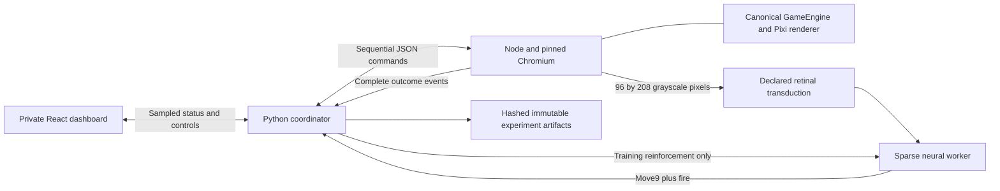

# Architecture and implementation boundaries

Baseline: `45c3695bbba53b1b15224616b60aea8a05480952`, `codex/scicon-experimental`. Existing Needlewing authoring/assets and unrelated local files were preserved. Each run archives and hashes the current relevant source tree, dependencies, frozen campaign, runtime and loaded assets; a Git hash alone is insufficient for a dirty checkout.

## Game boundary

`environment/core.ts` creates a fresh canonical `GameEngine`, freezes ORBIT ENTRY, RSC, three lives, no upgrades/supports and no external saves. It advances three 60 Hz ticks per 20 Hz decision. Native key-state injection leaves touch targets null. The renderer is called manually on every tick at deterministic times; observations use its completed framebuffer, not hidden object coordinates. Reset disposes/recreates engine and renderer. No RAF, wall-clock catch-up, visibility clock or `GameCanvas` loop participates.

The engine's optional research dependencies inject simulation time, independent game/cosmetic RNG, image handling, event sinks and a fixed performance policy. Normal calls omit these dependencies and preserve the existing behavior. Research mode prevents particle load from changing combat budgets. Scenario texture loading completes before tick zero and seals the asset set. Missing assets fail the episode visibly. The driver rejects nonlocal requests and every production `/api` path, including the private coordinator from the game browser.

Sequence numbers are checked at both driver and environment boundaries. A duplicate sequence with the same action returns the same result; a mismatched action fails. Exceptions during a partial step invalidate the episode. Dashboard reads retrieve the last completed frame and cannot advance the engine. Hardware timing diagnostics are excluded from deterministic state hashes.

## Process and persistence boundary

Vite has its own configuration, environment directory and dependency lock. It imports no production Vite proxy. The application never mounts production login, funding, settlement, receipts, analytics, leaderboard or profile modules. The startup script passes a small process environment allowlist; it does not load production environment files. Both servers bind loopback; mutations require the lab header and expected origin/Host.

The neural worker receives only a strict grayscale observation structure, signed reinforcement, simulation mode and checkpoint commands. Unknown request fields fail. It cannot call the game driver. An audit hook rejects evaluator-directory filesystem access in trusted Python; this is defense in depth, not an adversarial native-code or OS sandbox. The orchestrator owns all seeds and privileged state.

Commands have one in-flight response. Scientific action/event/reward/neural records are journaled synchronously with atomic Parquet partitions; sampled UI status can be skipped without affecting them. All actual grayscale observations are retained. Every action records state, grayscale and PNG hashes. Full neural checkpoints include dynamics, delayed spikes, filters, decoder, efficacy, eligibility, reinforcement queue, simulation clocks and RNG state where a model uses randomness. They are written through atomic replacement and checked by checksum and identity. Finalized runs are immutable and export checksums cover their files. An interrupted attempt is not silently promoted to a completed episode.

## Scientific layers

1. `data.py`: immutable original anatomical contact counts and exact IDs, membership policy and annotations.
2. `model.py`: declared numerical physiology and transmitter sign approximations, separately hashed.
3. `plasticity.py`: a separate efficacy vector for verified KC→MBON edges, independent of anatomy.
4. `vision.py` and `decoder.py`: graph-bound, evidence-bearing sensory and engineered effector manifests.
5. `worker.py`: explicit training/frozen modes, complete checkpointing and acquisition/expression interventions.
6. `study.py`: independent replica schedules, fixed evaluation, control preflight, donor/yoked reinforcement, matched action bouts and statistical analysis.

The reference backend is deliberately straightforward NumPy sparse/event propagation. Brian2 is an independent numerical oracle. A GPU, compiled backend or graded early-vision model must use a separate version and pass equation/state comparisons before replacing this reference. They have not been smuggled into the baseline as equivalent physiology.

## Production exclusion

The root TypeScript project excludes `fly-lab`; `.vercelignore` excludes it from deployment uploads; the production assertion tool rejects Fly Lab paths and markers in build output. There is no production route or link importing the lab. Python, datasets and experiment outputs are outside the production dependency tree. The lab can be removed without changing normal player persistence contracts.
