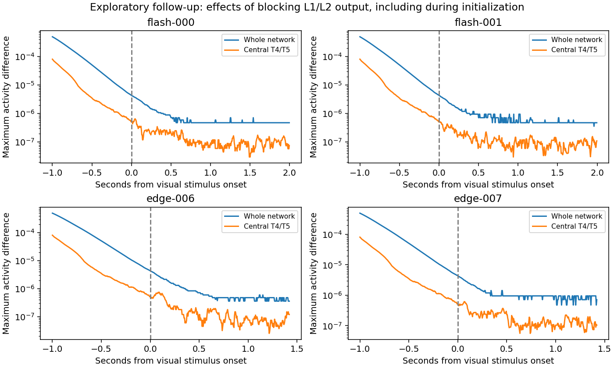

# Does the reference transmit through L1/L2?

This diagnostic followed the reference screen's observation that central L1/L2 activity stayed below the model's presynaptic-output threshold. It is explicitly **post-reference, hypothesis-driven work**, not a preregistered component of that screen, and cannot validate MaleCNS or game learning.

We reused four exact, source-verified inputs: bright/dark flashes and bright/dark edges at 90 degrees. Each was simulated under the original model, an unchanged sham wrapper, and a wrapper blocking outgoing L1/L2 transmission. The block applied during both the one-second gray initialization and the subsequent recording. Inputs from other cell types, node equations and stored parameters were preserved. Selection is by source type: a recurrent connection from a nominated source is also blocked, even if its target is L1/L2.

## Measurements

- 12 simulations completed in 135.51 seconds with two CPU threads and the sampled 4-GiB interruption threshold.
- The intervention selected 33,014 outgoing edges; 30,851 had nonzero weights to block. All other weights remained unchanged.
- All 721 L1 and 721 L2 cells had exactly zero rectified release throughout all four recorded inputs. Their internal graded values changed, but remained below zero.
- Every original central response matched its prior reference response by raw-byte hash. Every sham full-network array matched its original by raw-byte hash.
- The block produced a maximum full-network difference of 0.00049859 model units, at the first recorded frame, before the visual stimulus. This is a detected difference above the fixed `1e-6` threshold; it must not be described as a completely identical lesion result.

Exploratory time windows were chosen **after** seeing the initial maximum. By stimulus onset, the maximum whole-network difference was 0.0000043511. During the stimulus window, the maximum central T4/T5 differences ranged from `5.12e-7` to `7.51e-7`, below that threshold. Whole-network and nominated motion-cell measurements are different quantities.



These observations are consistent with initialization carryover, rather than substantial ongoing L1/L2 output during the recorded stimuli. They do not identify every alternative pathway, validate biological physiology, or show that real flies can dispense with L1/L2. A stimulus-only intervention from identical saved initial states would address initialization more directly. No such extra simulation is implied by this record.

The result argues against borrowing this checkpoint's L1/L2 operating parameters without further sensory calibration. A separate MaleCNS graded candidate still needs an explicit operating point, actual retained connections, documented omitted inputs and held-out physiological response tests.

## Records and reproduction

[Results](results.json) contain all arms, population summaries, full-network differences and hook audits. [Specification](specification.json) freezes the identity and intervention. [Exploratory results](exploratory/results.json) include raw-byte proofs, time-window measurements and the explicitly retrospective interpretation. The explanatory README is separate from those frozen records.

The complete diagnostic remains at `fly-lab/runtime/vision-reference/results/pathway-v1-20260913-first`; approximately 1.01 GB of compressed raw arrays is retained there. All 32 recorded files verify against [full-run-checksums.json](full-run-checksums.json). This committed subset intentionally omits the large whole-network arrays. [subset-checksums.json](subset-checksums.json) verifies the copied evidence. The exploratory directory contains its complete small analysis record, code and checksums.

Use the isolated environment described in [FLYVIS_REFERENCE.md](../../FLYVIS_REFERENCE.md). Restore the complete source reference record from [full-record.zip](../flyvis-reference-v1/full-record.zip) into the exact directory declared by the diagnostic specification; this preserves its metadata and input hashes. From `fly-lab`, with a new output directory:

```powershell
.\runtime\vision-reference\.venv\Scripts\python.exe scripts/flyvis-pathway-diagnostic.py --data-root runtime/vision-reference/data --output runtime/vision-reference/results/pathway-NEW-UNIQUE-ID
```

The [saved exploratory program](exploratory/analyze_windows.py) expects the original sibling runtime directory names. It is an archived analysis, not a CLI to run directly from this documentation subset. Reproduce its original layout with the complete raw records, or use a separately identified copy with new input paths. Do not overwrite the sealed original results.

[Official FlyVis dynamics and parameter hook](https://github.com/TuragaLab/flyvis/blob/v1.2.0/flyvis/network/dynamics.py).
