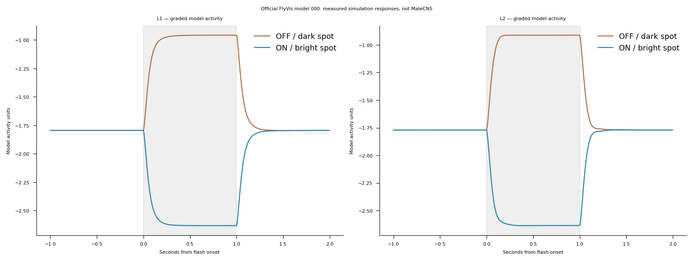
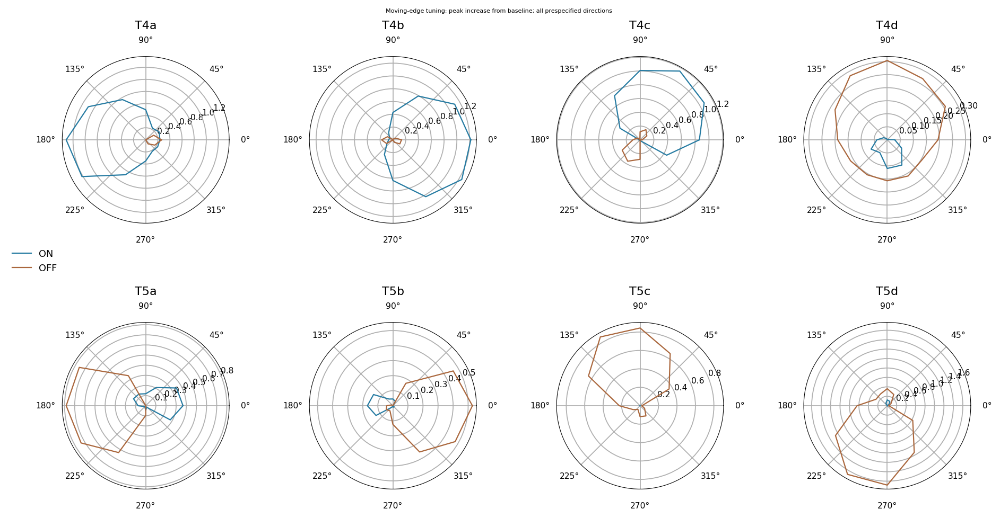

# Measured FlyVis reference screen, September 13, 2026

The frozen `flyvis-reference-v1` engineering screen completed on official model `flow/0000/000`: **PASS under its predefined criteria**, with important retained limitations. This is a single pretrained reference model on the authors' visual connectome. **MaleCNS vision, decoder, conditioning and learning gates are unchanged.**

| Measurement | Observed result |
|---|---|
| Nominated T4/T5 preferred-versus-opposite direction | 8 of 8 matched |
| Nominated T4/T5 ON/OFF contrast preference | 7 of 8 matched; T4d failed |
| Central L1/L2 flash polarity | Both decreased for ON and increased for OFF |
| Two fresh-state repeated stimuli | Bit-identical responses, maximum difference 0 |
| Gray-control maximum activity range | 0.0000622 model units |
| Weights and assay sources unchanged | Verified |
| Trials and total elapsed time | 29 trials; 426.17 seconds including preparation/cache recovery |

The protocol required at least six of eight matches for each selectivity measure. Its overall PASS does not erase T4d's individual failure: maximum OFF response was 0.30446 versus ON 0.11182, opposite the expected contrast preference. These are responses of a single nominated central cell per type, not biological population estimates.

Central L1/L2 traces stayed below zero throughout both flashes, despite changing with the expected polarity. FlyVis applies `ReLU(h)` to presynaptic activity, so these central cells' modeled outgoing release was zero in those trials. **This screen does not demonstrate tonic L1/L2 release or causal transmission through that pathway.** It also does not establish the mechanism producing T4/T5 responses. Source/target-current measurements and matched pathway interventions are the appropriate follow-up. This is a post-screen interpretation, not an added passing criterion.

Two CPU threads were used. Simulation RSS was observed around 2.1 GiB under a sampled 4-GiB interruption threshold. This was not a systematic hardware benchmark. The initial upstream dense renderer was terminated at 41,248 MiB before neural trials; the final sparse adapter matched upstream float32 inputs in the recorded small-eye and selected full-resolution comparisons. Earlier I/O/import failures and incomplete-cache recovery are retained in [attempts.json](attempts.json). No trial outcome was available in the interrupted attempts, no checkpoint was selected after seeing these responses, and response thresholds did not change between attempts.

## Artifact scope and reproduction

The loose files in this directory are a byte-preserving **subset** of the complete local record at `fly-lab/runtime/vision-reference/results/reference-v1-20260913-fourth`. The [full-record.zip](full-record.zip) additionally contains the complete original record: exact delivered inputs, all central-cell response traces, metadata, figures and 67 verified artifact hashes. Raw responses are available in that archive, not replaced by these summary plots. Extract it to the specified reference directory to reproduce a dependent diagnostic without changing its input identities.

- [results.json](results.json) preserves all criteria and individual cell metrics.
- [metadata.json](metadata.json) records checkpoint, code/specification hashes, runtime and adapters.
- [specification.json](specification.json) is the frozen measured protocol.
- [full-run-checksums.json](full-run-checksums.json) verifies the **complete original directory**; some named files intentionally are not in this subset.
- [subset-checksums.json](subset-checksums.json) verifies copied evidence and the attempt log. This explanatory README is separate commentary.
- [Setup and reproduction](../../FLYVIS_REFERENCE.md) describe the isolated optional environment and runner.

The model weights were trained by the authors on optic flow. They were held fixed here. No game, reinforcement, MaleCNS cell IDs or biological learning claim is part of this experiment. Reference response quality does not supply a validated parameter transfer to the MaleCNS circuit.
