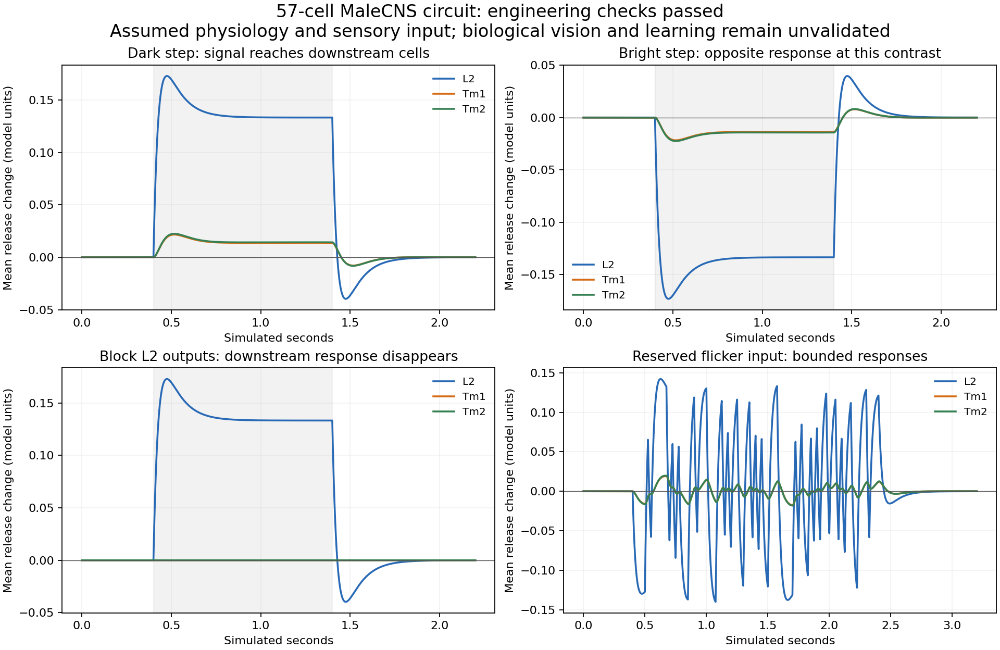

# Actual MaleCNS reduced visual-circuit diagnostic v1

**Result: the prespecified engineering checks passed. Biological vision and game
learning remain unvalidated.** This run occurred after Scott returned for a status
check on September 13; it did not run during the unattended overnight interval.



## What was measured

The exact right-side anatomical nomination contains 19 L2, 19 Tm1 and 19 Tm2
cells, 117 directed pairs and 6,193 contacts. Every internal connection was kept,
including weak and recurrent contacts. The patch omits 15,880 incoming contacts
from 742 outside cells, including substantial modeled inhibitory input. Its
adapted-boundary assumption is consequential, not an anatomical fact.

The protocol and exact anatomy/core/runner bytes were locally frozen before the
first actual-circuit response. This is a prospective local record, not external
preregistration. No parameters were fitted or changed in response to the trials.

Eleven stimulus sequences ran under four conditions: intact, an identical sham,
blocked L2 output and reversed input polarity. A finer-timestep repeat made
**45 independent reset trials**. These included zero contrast, bright/dark
200-ms flashes and 1-second steps, four reserved contrast amplitudes and two
reserved flicker seeds. The reserved inputs test bounded numerical behavior,
not generalization to a new biological dataset.

All eight engineering checks passed: exact adapted-baseline stability; finite,
bounded release; the same health checks on reserved stimuli; byte-identical sham
responses; no downstream deviation with L2 output blocked; detectable downstream
response to the two dark stimuli; timestep convergence; and unchanged source
bytes. The run took 29.95 seconds, with a peak sampled process RSS of
115,945,472 bytes (110.6 MiB), two numerical threads and a 100-ms memory sampler.
This is a 57-cell benchmark, not a full-connectome throughput estimate.

During the dark step, mean L2 release deviation peaked at 0.1730 model units;
Tm1 and Tm2 peaked at 0.02170 and 0.02247. Their positive peaks occurred at
75.5 ms and 116.75 ms respectively, relative to this step's onset. These are
model step-response measurements, **not** the published noise-filter peaks and
not an agreement claim. The decline during a sustained step reflects the
declared adaptation equation; it does not independently discover adaptation.

## Scientific interpretation

This demonstrates stable causal transmission through an actual anatomical patch
under explicitly assumed dynamics and boundary input. It removes one software
and modeling obstacle encountered by the previous silent all-LIF candidate.

OFF polarity is partly imposed by the negative-contrast input mapping. At the
development contrast, bright and dark responses are equal and opposite to
floating-point precision. This is expected in the unsaturated linear regime;
it does not reproduce or establish biological ON/OFF rectification. Blocking
L2 output also preserves the engineered adapted operating point rather than
modeling the full physiological effects of an acute biological intervention.

Baseline release, gains, time constants, adaptation and omitted input closure
are engineering hypotheses. The model has no calibrated retina, spatial
stimulus discrimination, visual-KC response, action decoder, reward or plasticity.
The whole-CNS vision/decoder/conditioning/learning gates were not changed.

An [independent saved-artifact audit](../graded-off-diagnostic-v1-independent-check.json)
verified all 57 listed hashes, all 45 complete traces, 11 byte-identical sham
comparisons and the declared equations against adjacent saved states. Halving
the timestep changed release by at most 0.0001988 model units, below the frozen
0.005 threshold. At the largest bright contrast, the assumed release floor
clipped L2 activity; the resulting contrast asymmetry is a model consequence,
not new evidence about biological selectivity. No adaptation-removal experiment
was included in this protocol.

The next step is quantitative physiological calibration with a declared
measurement model. [The source audit](../graded-off-physiology-sources-v1.md)
found published L2 voltage-imaging data. [The acquired aggregate targets](../graded-off-l2-target-inventory-v1.md)
contain mean curves but no individual-fly uncertainty or embedded stimulus
metadata. A paper/notebook timing discrepancy and normalization details need
reconciliation. Aggregate fitting alone will remain descriptive; an independent
biological validation needs appropriately separated records.

## Reproduce and inspect

Run from `fly-lab`, using the existing pinned Python environment:

```powershell
.venv/Scripts/python.exe scripts/graded-off-diagnostic.py --output runtime/graded-off/results/diagnostic-v1-reproduction
```

The runner requires an unused output directory, checks its frozen sources before
simulation, records every timestep's membrane deviation, adaptation, release and
input, and writes visible completion/failure status. It does not require loading
the full connectome: the exact extracted circuit is versioned in
`docs/evidence/graded-off-circuit-v1.json`. Regenerating that circuit independently
requires the official source files and compiled graph; use
`scripts/extract-graded-off-circuit.py --check` from the repository root with the
lab Python executable. The frozen numerical sources must retain their bytes.

The complete original record is local at
`runtime/graded-off/results/diagnostic-v1-20260913-first/` (58 files, approximately
237.5 MB). It includes all 45 complete state/input NPZ files, copied sources,
parameters, circuit and metadata. Its 57-entry checksum manifest excludes only
itself. Those complete traces remain in ignored runtime storage; this versioned
report contains summaries, the original raw-record checksum manifest and a
descriptive figure, not all raw traces. Do not treat the raw-record manifest as
a list of files promised inside this compact report folder.

To regenerate this figure from the original record, use the pinned reference
environment that contains Matplotlib:

```powershell
runtime/vision-reference/.venv/Scripts/python.exe scripts/report-graded-off.py --record runtime/graded-off/results/diagnostic-v1-20260913-first --output runtime/graded-off/reproduced-report
```

The plotting utility verifies the original artifact hashes before reading any
trace. A second installation can rerun the circuit from its versioned inputs;
exact cross-platform floating-point or figure identity is not assumed. Compare
the recorded arrays and declared tolerances, while allowing metadata timestamps
and resource measurements to differ.
